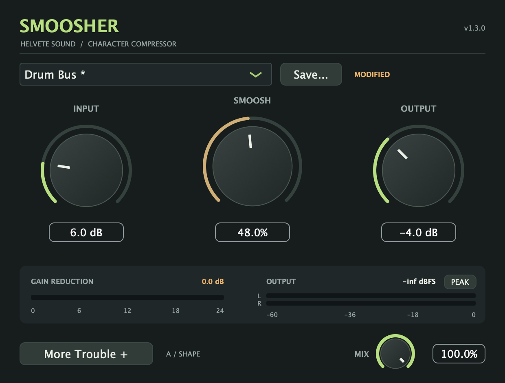

# Smoosher

A free audio compressor plugin with character, by Helvete Sound, LLC. One Smoosh knob combines compression, saturation, and frequency-sensitive detection.

Version **1.3.0 — Professional Help** adds **Couples Therapy** stereo linking, **Kick Privilege** detector bass filtering, and **Bad Decisions** variations inside **More Trouble**. Compare retains A/B, Undo/Redo, and Ego Check; Shape and Chaos contain the new tools. All features are free. Older sessions keep their sound with Stereo Link at 0% and the detector filter Off.

**[Download the 1.3.0 tester prerelease](https://github.com/seamoss/smoosher/releases/tag/v1.3.0)** — [signed and notarized Mac installer](https://github.com/seamoss/smoosher/releases/download/v1.3.0/Smoosher-1.3.0-macOS-universal.pkg), [Windows VST3](https://github.com/seamoss/smoosher/releases/download/v1.3.0/Smoosher-1.3.0-Windows.zip), and [checksums](https://github.com/seamoss/smoosher/releases/download/v1.3.0/SHA256SUMS.txt).



See the [quick start and meter guide](docs/USAGE.md), [More Trouble guide](docs/MORE-TROUBLE.md), and [1.3 release notes](docs/releases/1.3.0.md). Current screenshots are rendered from the actual 1.3.0 editor; meter readings depend on your audio.

## Controls

- **Smoosh, 0–100%:** controls compression threshold, ratio, attack, release, makeup gain, saturation, and filtering. Above 60%, Hammer mode adds faster attack and soft clipping.
- **Input, 0 to +30 dB:** drives the wet processing path.
- **Output, −12 to +12 dB:** trims the wet output after compression and soft clipping. This is not a final output ceiling; positive gain can produce peaks above 0 dBFS.
- **Mix, 0–100%:** blends the original dry input with the processed wet signal. Preset changes leave Mix alone.

The compact interface is 620 × 470 pixels, with a small Mix knob below the meters. **More Trouble +** expands it to 620 × 716 with Compare, Shape, and Chaos tabs. A/B, Copy, Undo, and Redo stay available on every tab. Each A/B slot includes all six controls, preset identity, and its learned match settings; both slots save with the session. Each control supports typed values, mouse-wheel adjustment, and double-click reset. Control changes ramp over 20 ms. Compression gain reduction is shown in dB; stereo output meters show the final output after dry/wet blending and any Ego Check correction with a 1.5-second peak hold. The CLIP indicator latches when either channel reaches 0 dBFS; click it to clear.

- **Couples Therapy, 0–100%:** links stereo gain reduction. At 100%, both channels receive the stronger reduction; at 0%, they remain independent. Mono is unaffected.
- **Kick Privilege, Off or 20–300 Hz:** reduces bass in the compression detector, leaving the audible bass path intact.
- **Bad Decisions:** generates Gentle, Questionable, or Unsupervised variations into the inactive A/B slot. Output and Mix start locked; all six controls have locks. Your active sound stays put, and Undo recovers the replaced slot.

Sixteen factory presets plus Init are included. The original seven:

| Preset | Smoosh | Input | Output |
| --- | --- | --- | --- |
| Hell Smarsh | 45% | +15 dB | +1 dB |
| Wenger's 7-String | 60% | +10.5 dB | +2 dB |
| That Joe Sound | 70% | +15 dB | 0 dB |
| Gravy River | 70% | +12 dB | +2 dB |
| Dani Time | 30% | +30 dB | +2 dB |
| Gloopy | 40% | +7.5 dB | +1 dB |
| Limit THIS! | 75% | +24 dB | +3 dB |

The 1.1 collection adds nine more starting points, from yacht rock to questionable life choices:

| Preset | Intended starting point | Smoosh | Input | Output |
| --- | --- | --- | --- | --- |
| Mr. Cetera | Gentle vocal/key polish. The marina needs a power ballad. | 24% | +6 dB | −3 dB |
| Dockside Divorce | More colour for a yacht-rock instrument bus. She got the boat. | 38% | +7.5 dB | −4.5 dB |
| Drum Bus | General drum-bus cohesion with moderate drive. A responsible adult. | 48% | +6 dB | −4 dB |
| Bass in Boat Shoes | Bass sustain for financially secure low end. | 42% | +9 dB | −5 dB |
| Snare Custody Battle | Hammer-mode snare attitude. Every other weekend is a fill. | 66% | +12 dB | −6 dB |
| Oops! All Room Mics | Heavy room-mic smash. The ceiling is now a band member. | 92% | +24 dB | −9 dB |
| Live, Laugh, Limit | Aggressive Hammer colour for parallel destruction. Hang it in the kitchen. | 85% | +18 dB | −7 dB |
| Divorced Dad Clean Tone | Light clean-guitar control. The chorus pedal is sold separately. | 20% | +4.5 dB | −3 dB |
| Hard Dick™ | '90s hair-metal guitar-bus sustain and Hammer-mode attitude. Spandex sold separately. | 73% | +12 dB | −5.5 dB |

Adjust Input for the source level and Output to level-match. These presets use the same processing as every other setting; their names describe starting points, not additional effects. Mix stays where you left it, so blend the heavier settings to taste.

Preset names and their original settings are saved with the session. An asterisk and MODIFIED label indicate edits to Input, Smoosh, Output, or either Shape control; changing Mix does not modify a preset. Older sessions without preset metadata infer a matching factory name or display Custom. Factory presets keep their original settings and reset Shape to its legacy defaults.

Use **Save...** to store a named user preset. User presets preserve Input, Smoosh, Output, and Shape, and leave Mix unchanged. They are saved in `~/Library/Application Support/Helvete Sound/Smoosher/Presets/` on macOS or `%APPDATA%/Helvete Sound/Smoosher/Presets/` on Windows. Existing preset files are not overwritten. Version 1 preset files still load with Shape off; new version 2 files require Smoosher 1.3 or later. Dani Time stores +30 dB explicitly, matching the supported input range.

## Installation

The [1.3.0 tester prerelease](https://github.com/seamoss/smoosher/releases/tag/v1.3.0) includes the assets below. It is marked as a prerelease while testers check wider DAW and OS compatibility. Previous releases remain available, including [1.2.0](https://github.com/seamoss/smoosher/releases/tag/v1.2.0). Older 1.0.0 downloads use the original ZIP/manual installation process.

### macOS

The release build targets **macOS 11 or later**, with both **Apple Silicon and Intel** code in each plugin. Hosted CI validates on macOS 15; the minimum OS target is not a claim that every OS/DAW combination has been tested.

1. Close your DAW and download `Smoosher-1.3.0-macOS-universal.pkg` from the published release.
2. Open the signed, notarized installer and follow the prompts. Administrator authorization is required because it installs for all users:
   - AU: `/Library/Audio/Plug-Ins/Components/Smoosher.component`
   - VST3: `/Library/Audio/Plug-Ins/VST3/Smoosher.vst3`
3. If upgrading from a manual installation, move old Smoosher copies out of `~/Library/Audio/Plug-Ins/Components/` and `~/Library/Audio/Plug-Ins/VST3/` to avoid duplicate versions. The installer does not remove per-user copies.
4. Open your DAW and rescan plugins if necessary.

The installer contains AU and VST3. The standalone app is available when building from source. Unsigned Actions artifacts are development builds, not the notarized release installer.

### Windows

1. Close your DAW and download `Smoosher-1.3.0-Windows.zip` from the published release.
2. Extract it and copy the entire `VST3/Smoosher.vst3` bundle into `C:\Program Files\Common Files\VST3\`. Administrator authorization may be required.
3. Open your DAW and rescan plugins if necessary.

The Windows release is x64 VST3. Apple signing and notarization apply only to the Mac release; the Windows ZIP is unsigned.

Each release includes `SHA256SUMS.txt` for verifying the downloaded files.

## Building from source

Requirements: Git, **CMake 3.22 or later**, and a C++17 compiler. The release uses **Xcode 16.4** on macOS, or Visual Studio 2022 with the Desktop development with C++ workload on Windows. CMake downloads the pinned JUCE **8.0.4** dependency during configuration. Newer Xcode releases may raise the minimum deployment target; use the release toolchain when reproducing its macOS 11 target.

```sh
git clone https://github.com/seamoss/smoosher.git
cd smoosher
```

### macOS universal AU and VST3

```sh
export DEVELOPER_DIR=/Applications/Xcode_16.4.app/Contents/Developer
cmake -S . -B build -G Xcode \
  '-DCMAKE_OSX_ARCHITECTURES=arm64;x86_64' \
  -DCMAKE_OSX_DEPLOYMENT_TARGET=11.0
cmake --build build --config Release --target Smoosher_AU Smoosher_VST3 --parallel 3
bash scripts/verify-macos.sh build/Smoosher_artefacts/Release
```

Outputs:

- `build/Smoosher_artefacts/Release/AU/Smoosher.component`
- `build/Smoosher_artefacts/Release/VST3/Smoosher.vst3`

Build the optional standalone app with `cmake --build build --config Release --target Smoosher_Standalone`. It is written to `build/Smoosher_artefacts/Release/Standalone/Smoosher.app`.

For local testing, close your DAW and explicitly install the plugins into your user directories. These commands replace any existing Smoosher copies at those destinations and refresh your user's Audio Unit registrar:

```sh
mkdir -p "$HOME/Library/Audio/Plug-Ins/Components" "$HOME/Library/Audio/Plug-Ins/VST3"
codesign --force --sign - build/Smoosher_artefacts/Release/AU/Smoosher.component
ditto build/Smoosher_artefacts/Release/AU/Smoosher.component "$HOME/Library/Audio/Plug-Ins/Components/Smoosher.component"
ditto build/Smoosher_artefacts/Release/VST3/Smoosher.vst3 "$HOME/Library/Audio/Plug-Ins/VST3/Smoosher.vst3"
killall -9 -u "$(id -un)" AudioComponentRegistrar 2>/dev/null || true
sleep 2
auval -v aufx Smsh Smsh
```

Local builds are not Developer ID signed or notarized. See [the release guide](docs/RELEASING.md) for distribution signing.

### Windows VST3

```powershell
cmake -S . -B build -G "Visual Studio 17 2022" -A x64
cmake --build build --config Release --target Smoosher_VST3 --parallel 4
```

The bundle is `build/Smoosher_artefacts/Release/VST3/Smoosher.vst3`. To install it from an elevated PowerShell:

```powershell
Copy-Item -Recurse -Force build\Smoosher_artefacts\Release\VST3\Smoosher.vst3 'C:\Program Files\Common Files\VST3\'
```

Builds do not install plugins automatically. Developers can opt in with `-DSMOOSHER_COPY_PLUGIN_AFTER_BUILD=ON`; leave it off for packaging and CI. For Debug, use `--config Debug` and the corresponding `Debug` output directory. The paths above use multi-configuration generators; other generators may use a different artifact layout.

## Development and validation

Pull requests and main/master pushes build macOS AU/VST3 and Windows VST3 without release credentials. CI checks both Mac architectures, bundle versions, and AU validation. Version tags additionally sign and notarize the installer, verify it with Gatekeeper, and create a draft GitHub release after all jobs pass. See [RELEASING.md](docs/RELEASING.md) for setup and the release checklist.

To run processor regression checks (legacy audio compatibility, Shape, randomization locks/ranges, A/B, Undo, Ego Check, routing, meters, smoothing, session recall, and user presets):

```sh
cmake -S . -B build -DSMOOSHER_BUILD_TESTS=ON
cmake --build build --config Release --target SmoosherTests
ctest --test-dir build -C Release --output-on-failure
```

For additional host compatibility testing, [pluginval](https://github.com/Tracktion/pluginval) supports AU/VST3 validation on macOS and VST3 on Windows:

```sh
/path/to/pluginval --strictness-level 5 --validate /path/to/Smoosher.vst3
```

DAW loading, session recall, and listening checks remain part of release verification. No Linux binary or AAX plugin is distributed by this workflow.

Run release-script tests with `python3 -m unittest discover -s tests -v`. They check version mismatches, missing credentials, notarization rejection/timeouts, success verification, and keychain cleanup using mocked external services; they do not contact Apple or access signing keys.

## Implementation

- `Source/PluginProcessor.cpp`: parameters, metering handoff, preset management, and state serialization.
- `Source/SmoosherDSP.h`: compression, saturation, smoothing, and audio measurements.
- `Source/PluginEditor.cpp`: controls, meters, and preset UI. Factory presets live in `SmoosherAudioProcessor::factoryPresets()`.
- `CMakeLists.txt`: version, stable plugin identifiers, formats, and JUCE dependency.
- `.github/workflows/build.yml`: CI and draft releases.
- `scripts/`: version checking, universal-binary verification, packaging, and notarization.

The wet signal path is input gain → tanh saturation → low-pass filtering → compression with frequency-sensitive detection → makeup gain → Hammer soft clipping → output gain. The result is blended with the original dry input, then Ego Check applies its optional frozen correction. Channels retain independent detector envelopes; Couples Therapy blends their gain reductions toward the stronger one. Kick Privilege filters only the detector.

Keep the existing bundle ID, manufacturer/plugin codes, and parameter IDs stable so DAWs can identify the plugin in existing sessions. The two Shape parameters are appended after the original four. With Shape at its legacy defaults, regression tests verify bit-for-bit output against the 1.2 DSP. Older sessions explicitly restore those defaults and retain their saved A/B and Ego Check settings. Oversampling is not included.

## License

This project is free and open source. Feel free to use, modify, and distribute.

## Credits and support

Built by Seánan McCullough, Helvete Sound, LLC, Portland, OR — [helvetesound.com](https://helvetesound.com). Built with [JUCE](https://juce.com/).

Report bugs and feature requests in [GitHub Issues](https://github.com/seamoss/smoosher/issues).
