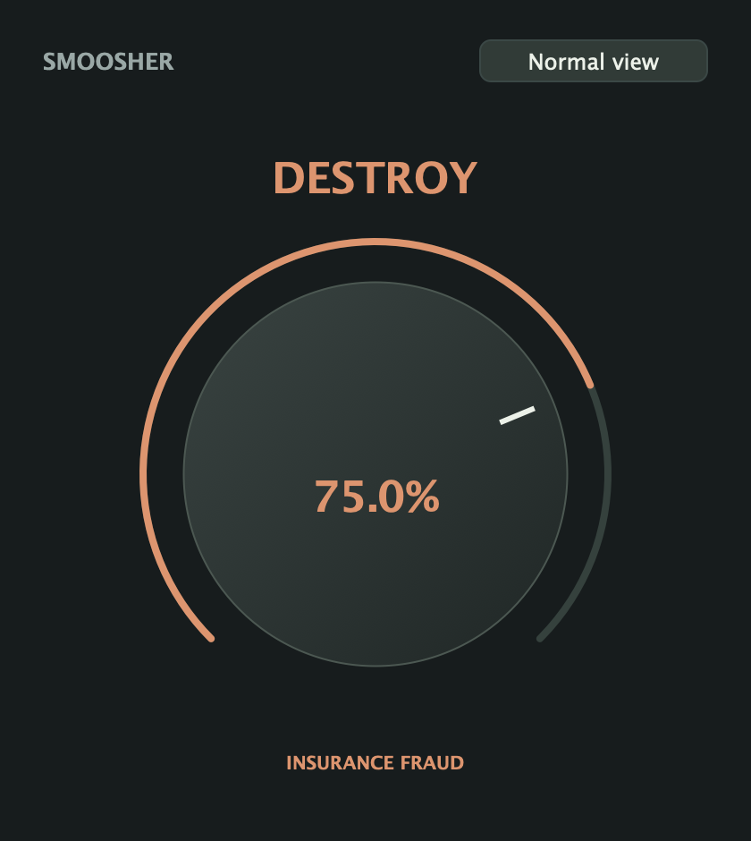
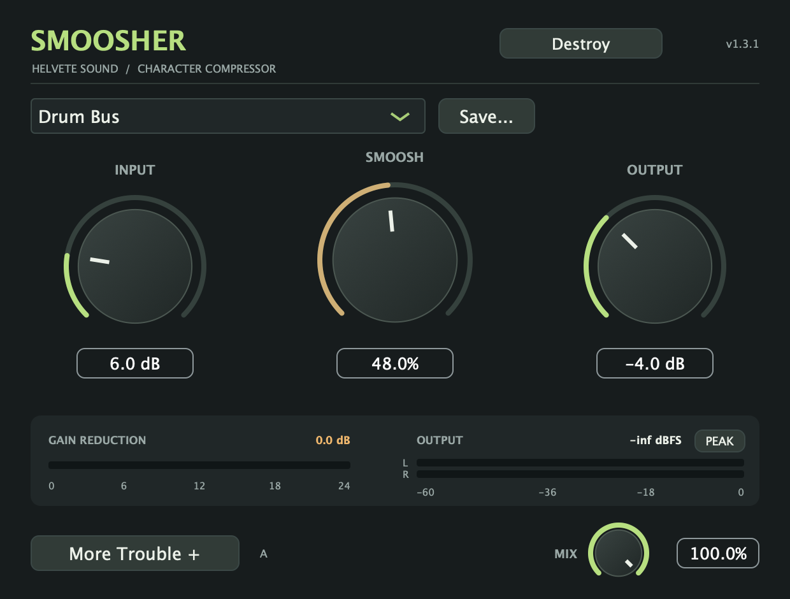
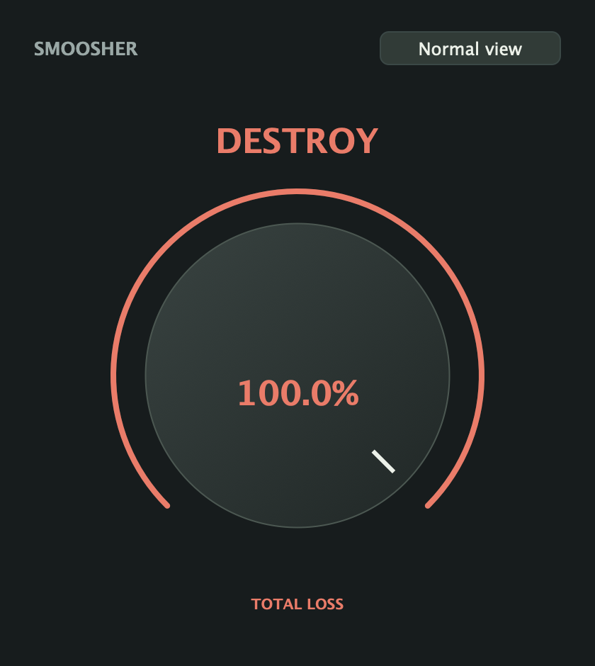

# Smoosher 1.3.1 — Destroy

[Download the 1.3.1 tester prerelease](https://github.com/seamoss/smoosher/releases/tag/v1.3.1). See the [installation guide](../README.md#installation) and [release notes](releases/1.3.1.md). All features remain free.

Click **Destroy** in the normal header to open a 420 × 470 view containing one large knob and a small **Normal view** return button. The amount appears inside the knob, with a damage description underneath. There are no other sound controls, presets, or meters in this view.

Drag or scroll to increase Destroy; double-click to reset to **0% / No Damage**. The knob follows a fixed, repeatable progression through drive, compression, Hammer clipping, parallel blend, and output compensation. It reaches **Total Loss** at 100%. It does not roll random settings. The output compensation is a fixed part of the curve, not adaptive loudness matching.

## Your Normal sound stays saved

Destroy has its own amount and processing path. It does not rewrite any of Normal's six controls, preset identity, A/B slots, or frozen Ego Check correction. **Normal view** returns to those settings and restores the drawer and tab you left open. Normal's compressor envelopes continue following the input while Destroy is active; mode changes crossfade over 20 ms.

Ego Check applies only to Normal. Entering Destroy cancels unfinished learning and releases Hold for Dry while retaining an earlier learned correction. At 0%, Destroy passes clean input regardless of Normal's settings.

Both the Destroy amount and its mode switch are automatable and save with the session. The six existing parameter IDs and their order are unchanged; the two new parameters are appended. Old sessions explicitly initialize Destroy off with its amount at zero, even when loaded into an instance that previously used it.

Destroy gestures and mode changes participate in grouped Undo/Redo. Undo remains in Normal's More Trouble drawer; undoing a return to Normal reopens Destroy. Destroy is separate from the Normal A/B slots and user preset files, so save your DAW session to retain it.

## The fixed curve

Intermediate settings interpolate between these points; the existing 20 ms control smoothing remains in effect. These are implementation details, not additional controls in the Destroy view.

| Destroy | Smoosh | Input | Wet output | Wet mix | Stereo Link | Detector filter |
| --- | --- | --- | --- | --- | --- | --- |
| 0% | 0% | 0 dB | 0 dB | 0% | 100% | 90 Hz |
| 15% | 25% | +4.5 dB | −3 dB | 35% | 100% | 100 Hz |
| 30% | 48% | +9 dB | −6 dB | 55% | 100% | 100 Hz |
| 50% | 72% | +18 dB | −8 dB | 78% | 100% | 120 Hz |
| 75% | 90% | +24 dB | −9 dB | 92% | 100% | 100 Hz |
| 100% | 100% | +30 dB | −10 dB | 100% | 100% | 60 Hz |

Normal uses the existing single processing path when Destroy is off. Destroy runs both paths to preserve Normal's envelopes and allow crossfading, so it uses more CPU. Scratch storage is allocated during preparation; oversized host blocks are processed in chunks without audio-thread allocation. No latency is added.

## Preview and validation

The screenshots come from the actual 1.3.1 editor. Local universal AU/VST3/standalone builds, processor regression tests, bundle/version checks, Apple Silicon and Intel AU validation, VST3 pluginval strictness 5 with GUI tests skipped, and five release-script tests passed. New tests cover the single-knob view, session migration, Undo/Redo, clean zero, frozen Normal matching, oversized buffers, 20 ms mode transitions, block-size-independent smoothing, reference-signal output levels, and bit-identical Normal audio before and after Destroy.

Standalone inspection also verified the knob, returning to the existing Normal controls and drawer, and reopening Destroy with its remembered amount. Audio input remains muted in the standalone preview until enabled through its audio settings.

The Mac release installer is Developer ID signed, notarized, and stapled; the Windows x64 VST3 ZIP is unsigned. Broader DAW playback and older-OS coverage remain tester work. Release-specific verification is recorded in the [release notes](releases/1.3.1.md).
