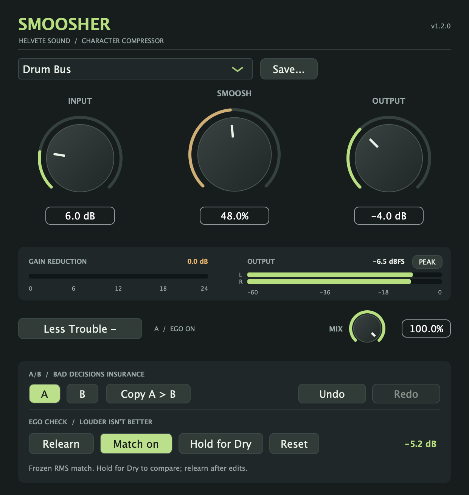
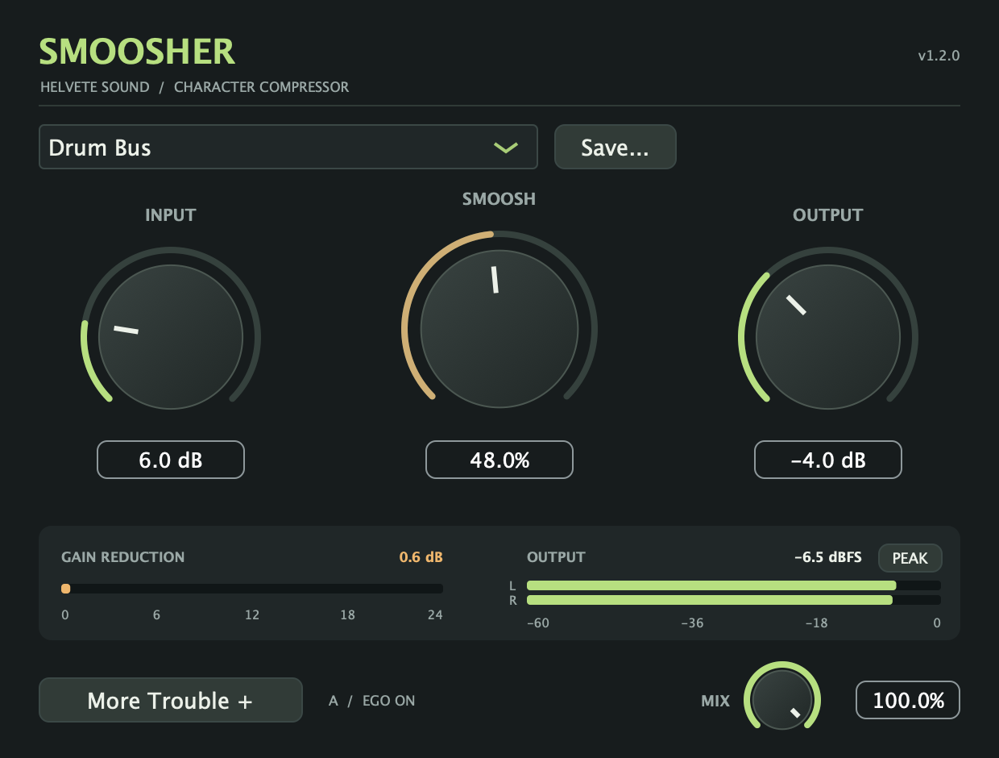

# Smoosher 1.2 — More Trouble

**Smoosher 1.2.0** adds A/B, Undo/Redo, and Ego Check in the collapsible More Trouble drawer. All features remain free. See the [tester release](https://github.com/seamoss/smoosher/releases/tag/v1.2.0) for downloads and the [quick start](USAGE.md) for the main controls.

The main controls and compression curves are unchanged. **More Trouble +** opens the comparison tools beneath the existing interface; **Less Trouble −** closes them. The main view remains 620 × 470 pixels, expanding to 620 × 654. Each session remembers whether the drawer was open.

The screenshots are rendered from the actual 1.2 editor processing an example test signal. Meter readings and the learned correction depend on your audio.

Compact view

## A/B: bad decisions insurance

1. Dial in a sound in **A**.
2. Select **B**. The first time, it starts as a copy of A.
3. Change B, then use **A** and **B** to compare.
4. **Copy A > B** (or **Copy B > A**) replaces the other slot with the current one.

Each slot keeps Input, Smoosh, Output, **Mix**, the preset name and original preset settings, plus its learned Ego Check correction and on/off state. The selected slot is indicated beside the drawer button even when the drawer is closed. Both slots and the selection save with the DAW session.

Switches use the existing control smoothing. Copying and switching are undoable. A/B does not capture compressor envelope history or rewind playback, so compare similar passages. Host automation still controls the four main parameters; A/B does not override subsequent automation.

## Undo: mistakes are a creative process

**Undo** and **Redo** work across knob drags, typed values, wheel adjustments, double-click resets, preset loads, A/B switches and copies, and Ego Check changes. A whole knob drag or preset load is one step. Hover either button to see the next action.

The last 64 local edits are kept while the plugin instance is open, including when its editor is closed. Loading a session starts with fresh history. A new edit clears Redo. Host automation is excluded from local history and invalidates older local edits so Undo cannot restore stale settings over a newer automation pass.

Undoing a saved preset's name does **not** delete its file. User preset files continue to contain Input, Smoosh, and Output only; Mix, A/B, and Ego Check are session settings.

## Ego Check: is it good, or just loud?

1. Play a representative passage with the desired Input, Smoosh, Output, and Mix settings.
2. Click **Learn**. It measures four seconds of audible input and processed output.
3. The learned correction turns **Match on** automatically, then stays frozen.
4. Hold **Hold for Dry** to hear the original input; release to hear Smoosher again.
5. Use **Match on/off** to bypass the correction, **Relearn** after changing the sound, or **Reset** to clear it.

The correction applies after Mix and before the output meters. The main Output knob still trims only the wet path. **EGO ON** remains visible beside More Trouble while the correction is active. Gain changes and dry audition crossfade over 20 ms; both channels share the same correction.

Learning uses channel-averaged RMS energy, with 100 ms windows and a −60 dBFS input gate. It first allows 250 ms for processing to settle, collects four seconds of qualifying windows, and gives up after 20 seconds of processed audio if there is not enough signal. A stopped transport supplies no samples, so learning waits until playback resumes or you press Cancel. This is an RMS comparison, not a perceptual or LUFS measurement; listen to the result.

The correction is limited to −48 through +18 dB. Silence and effectively silent output do not produce a correction. The UI reports when the correction reaches a limit. Ego Check is not a peak limiter; the output meters and latched CLIP indicator still matter.

Changing a control, loading a preset, or switching A/B during learning cancels that measurement. **Cancel** preserves any earlier correction. Undo during learning cancels it first. A completed match keeps its frozen value after later edits; use Relearn when you want a new comparison. Learning can finish with the editor closed, and its result is saved with the session. Closing the drawer or editor always releases dry audition; dry audition itself is never saved.

Older sessions load with Ego Check off, A selected, and the drawer closed. With Ego Check off and dry audition released, the existing processing path is unchanged.

## Validation and tester feedback

The processor regression suite covers grouped undo/redo, preset identity and modified state, A/B copies and session recall, concurrent automation, RMS learning at 44.1/48/96 kHz, silence and cancellation, frozen correction, dry audition, meter placement, and unchanged output when Ego Check is off.

Local validation on November 11, 2026 passed the processor suite, all five release-script tests, universal bundle/version checks, AU validation on Apple Silicon and Intel, and VST3 pluginval strictness 5 with GUI tests skipped. Standalone checks verified expanding/collapsing the drawer, A/B Mix recall, Undo/Redo, and Learn/Cancel. Release-specific CI and download verification results are recorded in the [1.2 release notes](releases/1.2.0.md).

When testing this prerelease, exercise both AU and VST3 in your DAW: switch A/B during playback, undo typed values and drags, learn on a bus, reopen the editor, and save/reload the session. Check the normal and expanded window sizes in the host. Report issues with your OS, DAW/version, plugin format, sample rate, buffer size, and reproduction steps.
