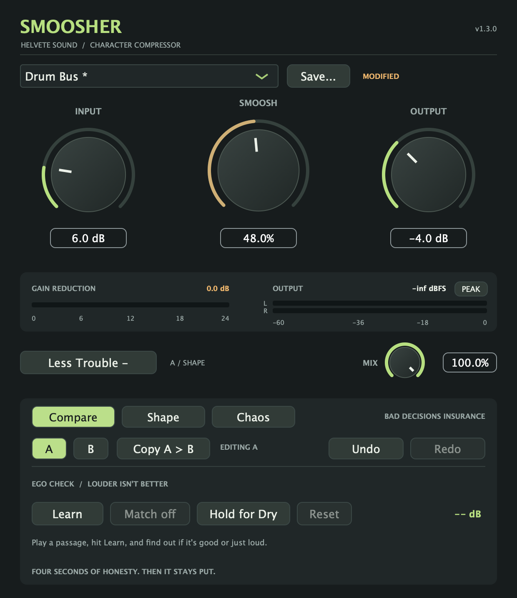
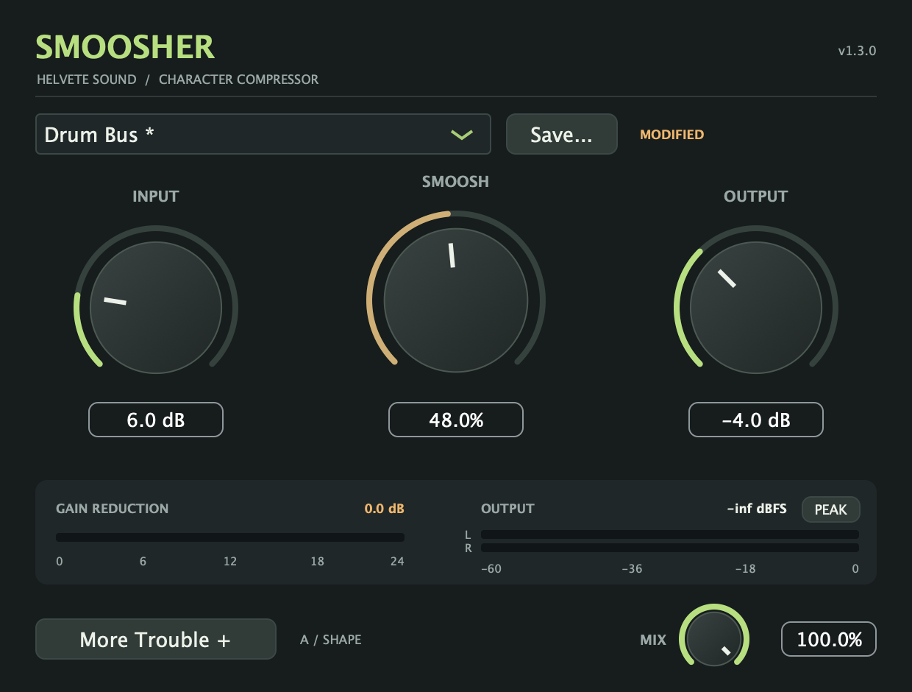
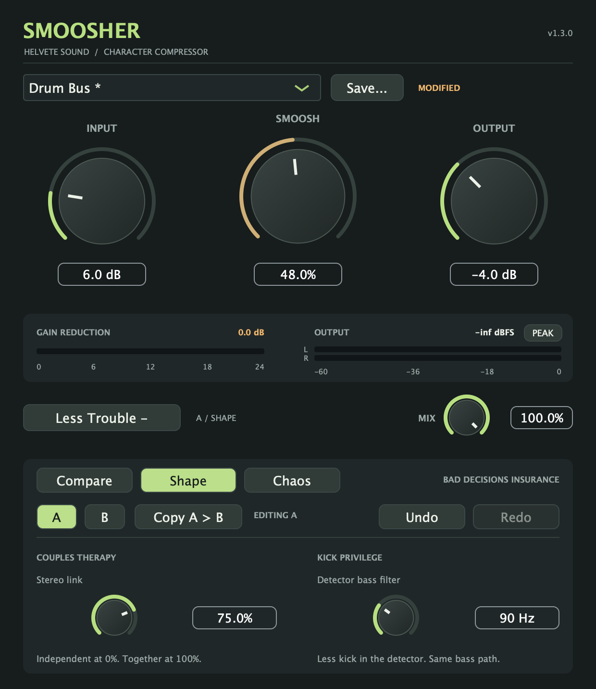
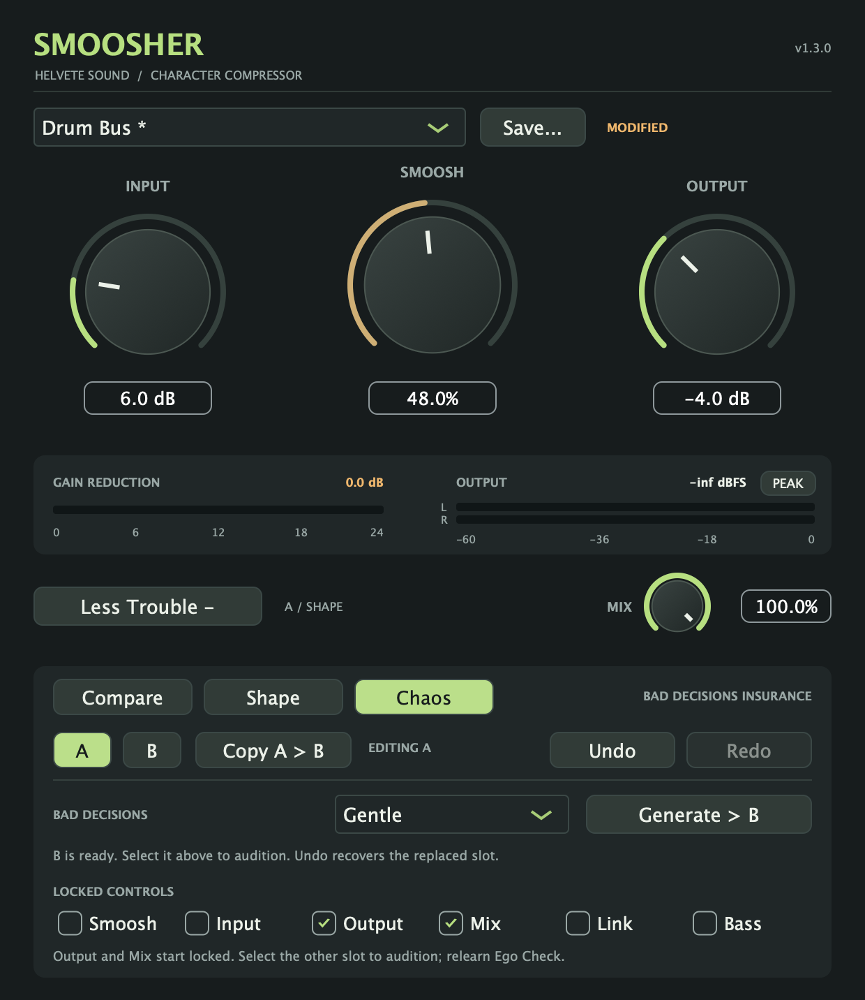

# Smoosher 1.3 — More Trouble

**Smoosher 1.3.0** adds Couples Therapy, Kick Privilege, and Bad Decisions to the collapsible More Trouble drawer, alongside A/B, Undo/Redo, and Ego Check. All features remain free. See the [tester release](https://github.com/seamoss/smoosher/releases/tag/v1.3.0) for downloads and the [quick start](USAGE.md) for the main controls.

**More Trouble +** opens **Compare**, **Shape**, and **Chaos** beneath the main interface; **Less Trouble −** closes the drawer. The main view remains 620 × 470 pixels, expanding to 620 × 716. A/B, Copy, Undo, and Redo remain available on every tab. Each session remembers whether the drawer was open and which tab was selected.

The screenshots are rendered from the actual 1.3 editor. Meter readings and the learned correction depend on your audio.

Compact view

## A/B: bad decisions insurance

1. Dial in a sound in **A**.
2. Select **B**. The first time, it starts as a copy of A.
3. Change B, then use **A** and **B** to compare.
4. **Copy A > B** (or **Copy B > A**) replaces the other slot with the current one.

Each slot keeps Input, Smoosh, Output, **Mix**, **Stereo Link**, **Detector Bass Filter**, the preset name and original preset settings, plus its learned Ego Check correction and on/off state. The selected slot is indicated beside the drawer button even when the drawer is closed. Both slots and the selection save with the DAW session.

Switches use the existing control smoothing. Copying and switching are undoable. A/B does not capture compressor envelope history or rewind playback, so compare similar passages. Host automation controls all six parameters; A/B does not override subsequent automation.

## Undo: mistakes are a creative process

**Undo** and **Redo** work across knob drags, typed values, wheel adjustments, double-click resets, preset loads, A/B switches and copies, Ego Check changes, and Bad Decisions generation. A whole knob drag, preset load, or generation is one step. Hover either button to see the next action.

The last 64 local edits are kept while the plugin instance is open, including when its editor is closed. Loading a session starts with fresh history. A new edit clears Redo. Host automation is excluded from local history and invalidates older local edits so Undo cannot restore stale settings over a newer automation pass.

Undoing a saved preset's name does **not** delete its file. User preset files contain Input, Smoosh, Output, and both Shape controls; Mix, A/B, and Ego Check are session settings.

## Ego Check: is it good, or just loud?

1. Play a representative passage with the desired Input, Smoosh, Output, and Mix settings.
2. Click **Learn**. It measures four seconds of audible input and processed output.
3. The learned correction turns **Match on** automatically, then stays frozen.
4. Hold **Hold for Dry** to hear the original input; release to hear Smoosher again.
5. Use **Match on/off** to bypass the correction, **Relearn** after changing the sound, or **Reset** to clear it.

The correction applies after Mix and before the output meters. The main Output knob still trims only the wet path. **EGO ON** remains visible beside More Trouble while the correction is active. Gain changes and dry audition crossfade over 20 ms; both channels share the same correction.

Learning uses channel-averaged RMS energy, with 100 ms windows and a −60 dBFS input gate. It first allows 250 ms for processing to settle, collects four seconds of qualifying windows, and gives up after 20 seconds of processed audio if there is not enough signal. A stopped transport supplies no samples, so learning waits until playback resumes or you press Cancel. This is an RMS comparison, not a perceptual or LUFS measurement; listen to the result.

The correction is limited to −48 through +18 dB. Silence and effectively silent output do not produce a correction. The UI reports when the correction reaches a limit. Ego Check is not a peak limiter; the output meters and latched CLIP indicator still matter.

Changing a control, loading a preset, switching A/B, or generating a variation during learning cancels that measurement. **Cancel** preserves any earlier correction. Undo during learning cancels it first. A completed match keeps its frozen value after later edits; use Relearn when you want a new comparison. Learning can finish with the editor closed, and its result is saved with the session. Leaving Compare, closing the drawer, or closing the editor always releases dry audition; dry audition itself is never saved.

Sessions from before 1.2 load with Ego Check off, A selected, and the drawer closed. Existing 1.2 sessions retain both A/B slots and their Ego Check settings. Sessions from before 1.3 explicitly initialize Stereo Link to 0% and the detector filter to Off, including when loaded into an instance that already used Shape.

## Shape: Couples Therapy and Kick Privilege

**Couples Therapy / Stereo Link** runs from 0% to 100%. At 0%, channels compress independently as in 1.2. At 100%, both receive the stronger gain reduction. Intermediate settings blend each channel toward that shared reduction. This links compression without summing the audio or changing stereo width. Saturation and Hammer clipping keep their per-channel behavior. Mono processing is unaffected, and the control is disabled for mono. Double-click to return to 0%.

**Kick Privilege / Detector Bass Filter** is Off, or 20–300 Hz. Two high-pass stages reduce bass in the compression detector, leaving the audible signal path intact. Try 80–150 Hz on a drum bus to reduce how strongly the kick drives compression, then adjust by ear. The filter has a 12 dB/octave rolloff, approximately −6 dB at the selected frequency, and retains the existing Smoosh-dependent detector weighting. Changes and bypass transitions are smoothed over 20 ms. Double-click or type **Off** to bypass it.

Both controls are automatable and included in A/B, Undo, sessions, and new user presets. **SHAPE** remains visible beside More Trouble whenever either is active. A completed Ego Check match stays frozen after Shape edits; relearn it when comparing the new sound.

## Chaos: Bad Decisions

1. Dial in a sound in A or B.
2. Choose **Gentle**, **Questionable**, or **Unsupervised**.
3. Check controls to **lock** their values. Output and Mix start locked.
4. Click **Generate > B** or **Generate > A** to replace the inactive slot with a variation. The active controls and audio stay unchanged.
5. Select the other slot to audition it. Undo can recover the replaced slot.

Gentle varies Smoosh by up to 8 percentage points, Input by 2 dB, Output by 1 dB, Mix by 8 points, Link by 15 points, and the detector filter by 40 Hz. Questionable widens those amounts to 25 points, 6 dB, 3 dB, 25 points, 40 points, and 100 Hz. Unsupervised explores each unlocked control's full legal range. Values are clamped and snapped to supported steps, including the filter's Off/20 Hz transition. Boundary rolls still change at least one unlocked control.

Locks copy the corresponding value from the active sound. Locking all six disables generation. Generated variants are named **Bad Decision** and start with Ego Check cleared; learn a fresh match for the new sound. Generating during an unfinished measurement cancels that measurement while preserving the active slot's earlier correction. Save a generated sound as a normal user preset if you like it.

Amount and locks save with the session. Undo/Redo restore the actual generated values without rerolling them; the tab, amount, and lock preferences are not Undo steps.

## Preset compatibility

Factory presets retain their original settings and reset Shape to 0%/Off. User preset files saved by 1.3 use version 2 and include Shape; older plugin versions cannot read them. Version 1 files still load with Shape at its legacy defaults. Mix remains independent of preset changes.

## Validation and tester feedback

The processor regression suite covers bit-for-bit comparison against the 1.2 DSP in mono/stereo at 44.1/48/96 kHz, stereo linking, detector-only filtering, smoothing across block sizes, legacy session and preset migration, variation ranges and locks, and recovery of overwritten slots. It also retains grouped Undo/Redo, preset identity, A/B recall, concurrent automation, RMS learning, cancellation, frozen correction, dry audition, and meter checks.

Local validation on November 11, 2026 passed the processor suite, all five release-script tests, universal bundle/version checks, AU validation on Apple Silicon and Intel, and VST3 pluginval strictness 5 with GUI tests skipped. Separate editor checks verified Shape gestures, Undo/Redo, and history persistence through timer updates. Release-specific validation status is recorded in the [1.3 release notes](releases/1.3.0.md).

When testing this prerelease, exercise both AU and VST3 in your DAW: automate Shape, generate and audition variations, switch A/B during playback, undo typed values and drags, learn on a bus, reopen the editor, and save/reload old and new sessions. Check the normal and expanded window sizes in the host. Report issues with your OS, DAW/version, plugin format, sample rate, buffer size, and reproduction steps.
