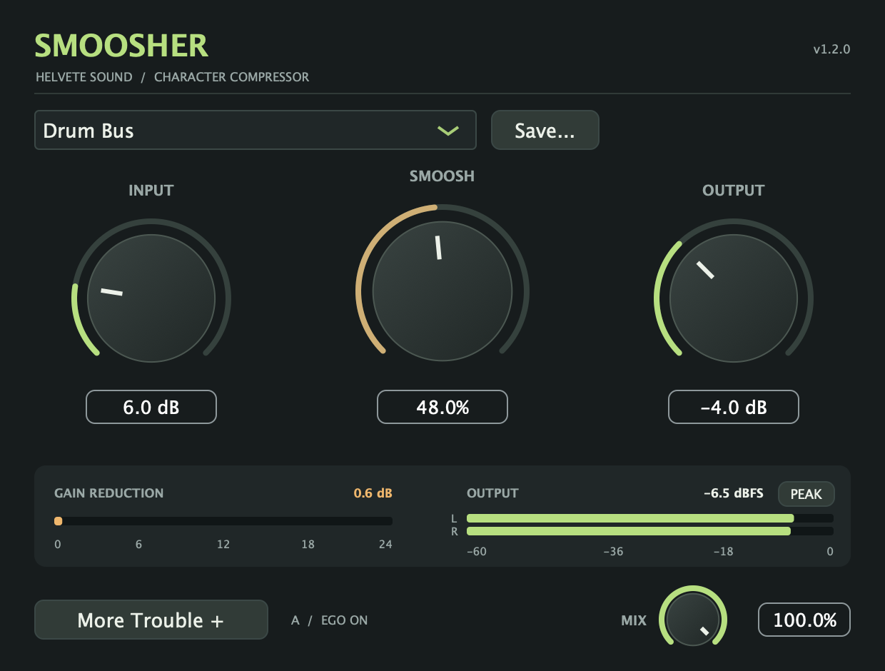
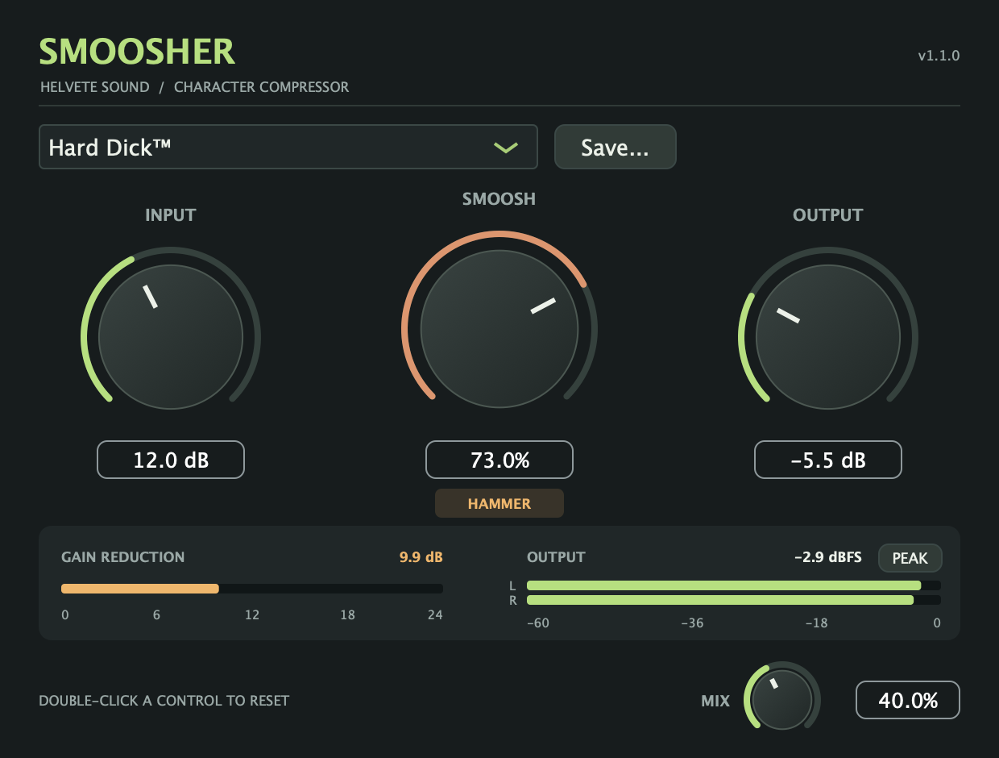

# Using Smoosher 1.2.0

[Download the tester prerelease](https://github.com/seamoss/smoosher/releases/tag/v1.2.0). The [installation instructions](../README.md#installation) cover the signed/notarized universal Mac AU/VST3 installer and unsigned Windows x64 VST3 bundle.

## Start here

1. Insert Smoosher on an audio track or bus and play some audio.
2. Start with **Init**, or choose a factory preset such as **Mr. Cetera** for gentle polish or **Drum Bus** for a drum-bus starting point.
3. Increase **Input** to drive the processing, then adjust **Smoosh** for compression and colour.
4. Use **Output** to level-match the result. It trims the wet signal and can still push final peaks above 0 dBFS.
5. Blend with **Mix**. At 0%, you hear the original dry input; at 100%, you hear the processed signal. Changing presets leaves Mix where you set it.
6. Open **More Trouble +** for [A/B, Undo/Redo, and Ego Check](MORE-TROUBLE.md). Learn on a representative passage, then use Hold for Dry to compare the frozen RMS match with your input.

The numbers beneath the knobs are editable. Click a value to type a precise setting; press Enter to apply it or Escape to cancel. Drag or use the mouse wheel to adjust a knob, and double-click the knob to reset it. Input, Smoosh, and Output reset to zero; Mix resets to 100%. Parameter changes are smoothed over 20 ms.

The standalone app starts with its input muted to avoid feedback. For normal plugin use, audio comes from the track or bus in your DAW.

## Read the meters

| Display | What it shows |
| --- | --- |
| Gain reduction | Compressor gain reduction in dB, using the greater reduction across the two channels. The bar spans 0–24 dB. It does not include saturation or output trimming. |
| Output L/R | Final stereo peaks after wet/dry blending, Ego Check, and dry audition, from −60 to 0 dBFS. Mono input is shown on both bars. |
| Numeric dBFS readout | The higher output peak, held for 1.5 seconds before falling. |
| PEAK / CLIP button | Turns red and stays latched when either output channel reaches 0 dBFS. Click to clear the clip indicator and held peak. |

Gain reduction can read zero when the input is below the compressor's threshold. Increase Input if you want more compression, and reduce Output as needed to level-match. The compressor channels remain independent; this version does not add stereo linking.

## Hammer mode

Above 60% Smoosh, the **HAMMER** indicator appears. This part of the range adds faster attack and soft clipping to the existing processing. It can suit aggressive guitar, snare, or room-mic starting points; use Mix to blend those settings with the dry signal.

**Hard Dick™** starts at 73% Smoosh, +12 dB Input, and −5.5 dB Output. The screenshot uses 40% Mix as an example; the preset itself does not change Mix. See the [full factory preset table](../README.md#controls) for all 16 presets plus Init.

The main screenshot comes from the actual 1.2.0 editor processing an example test signal; the Hammer example is from 1.1.0 and shows the same main controls. Meter values are illustrative measurements, not target levels for your material.

## Save and recall presets

- **Save...** stores Input, Smoosh, and Output under a new name. Existing preset files are not overwritten.
- User presets appear in the preset menu's **USER** section. Mix remains independent.
- An asterisk and **MODIFIED** label appear when you change one of a preset's three stored controls.
- Saving a DAW session preserves both A/B slots, all four controls, preset identity and modified state, each slot's Ego Check settings, and the drawer position. Undo history and momentary dry audition are not saved. Older sessions infer a matching factory name or show **Custom**.
- macOS preset folder: `~/Library/Application Support/Helvete Sound/Smoosher/Presets/`.
- Windows preset folder: `%APPDATA%/Helvete Sound/Smoosher/Presets/`.

## Help test this release

Try plugin scanning, playback, automation, new and existing session recall, user preset saving, and the meters. [Report issues](https://github.com/seamoss/smoosher/issues) with your OS, DAW/version, AU or VST3 format, sample rate, buffer size, and the steps that reproduce the issue.

See the [1.2 release notes](releases/1.2.0.md) for CI and download verification results. Broader DAW and minimum-OS coverage remains the purpose of this tester prerelease.
