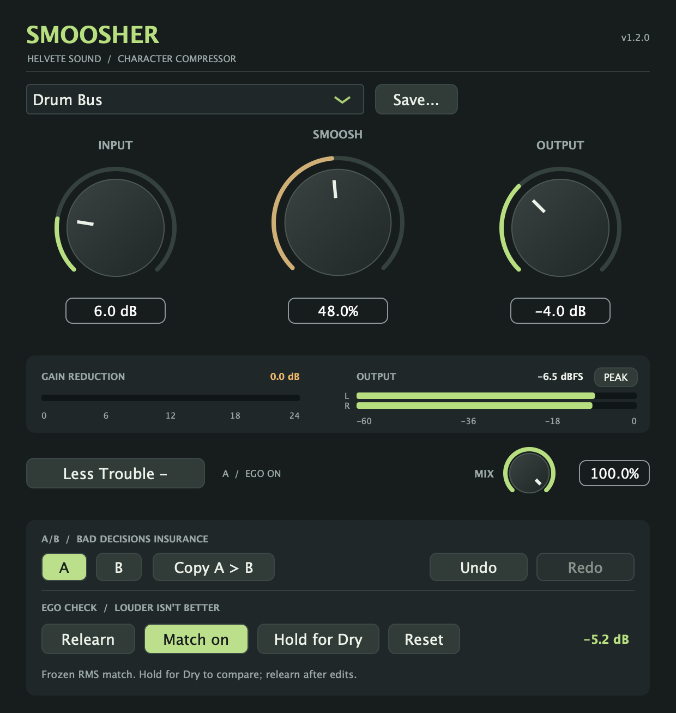

# Smoosher 1.2.0 — More Trouble

A/B, Undo, and an Ego Check. Still free. Still ridiculous. This tester prerelease keeps the main interface compact and puts the new comparison tools in **More Trouble**.

## What's new

- **A/B snapshots** include Input, Smoosh, Output, Mix, preset identity, and each slot's Ego Check settings. Both slots save with your session. B starts as a copy of A; copying and switching are undoable.
- **Undo/Redo** keeps 64 local edits. A knob drag or preset load is one step. Host automation is excluded and clears stale history; reopening the editor keeps history, while loading a session starts fresh.
- **Ego Check** learns four seconds of audible RMS, applies a correction after Mix, then freezes it. Use Match on/off, Relearn, Reset, and **Hold for Dry** to compare with your original input. It is RMS matching, not LUFS measurement or a peak limiter.
- **More Trouble** expands the 620 × 470 main view to 620 × 654. The active slot and EGO ON indicator stay visible when the drawer is closed.
- Existing compression curves, plugin IDs, parameter IDs, and factory presets are retained. Older sessions load with Ego Check off. With the new utilities off, the processing output is unchanged.

## Downloads

- **macOS:** [Smoosher-1.2.0-macOS-universal.pkg](https://github.com/seamoss/smoosher/releases/download/v1.2.0/Smoosher-1.2.0-macOS-universal.pkg) installs AU and VST3 for Apple Silicon and Intel. Requires macOS 11 or later and administrator authorization. Release installers are Developer ID signed, notarized, and stapled.
- **Windows:** [Smoosher-1.2.0-Windows.zip](https://github.com/seamoss/smoosher/releases/download/v1.2.0/Smoosher-1.2.0-Windows.zip) contains the unsigned x64 VST3 bundle, README, guides, and screenshots. Extract it and copy the entire `VST3/Smoosher.vst3` bundle to `C:\Program Files\Common Files\VST3\`.
- **Checksums:** [SHA256SUMS.txt](https://github.com/seamoss/smoosher/releases/download/v1.2.0/SHA256SUMS.txt) covers both downloads.

Close your DAW before installing. When upgrading from a manual Mac install, move old per-user Smoosher copies out of `~/Library/Audio/Plug-Ins/Components/` and `~/Library/Audio/Plug-Ins/VST3/` to avoid duplicate versions, then rescan in your DAW. The Mac installer writes to the system `/Library/Audio/Plug-Ins/` directories.

## Interface and guides

Read the [quick start](../USAGE.md) and [More Trouble guide](../MORE-TROUBLE.md). Screenshots are rendered from the actual editor using an example signal; meter readings and learned corrections depend on your audio.

## Validation and feedback

Local checks passed the processor regression suite, release-script failure tests, universal Mac architecture/version checks, AU validation on Apple Silicon and Intel, and VST3 pluginval strictness 5 with GUI tests skipped. Standalone checks covered the compact/expanded views, A/B recall, Undo/Redo, and Learn/Cancel. Release CI and downloaded-asset verification are completed before publication.

Please test AU/VST3 scanning, playback, automation, typed values and Undo, A/B changes, learning on real material, and reopening both older and new sessions. Wider DAW coverage, real Windows DAW playback, clean-machine installation, and older supported macOS versions still need tester feedback. Windows binaries are unsigned; matching does not guarantee a peak ceiling.

[Report issues](https://github.com/seamoss/smoosher/issues) with your OS, DAW/version, format, sample rate, buffer size, and reproduction steps.
