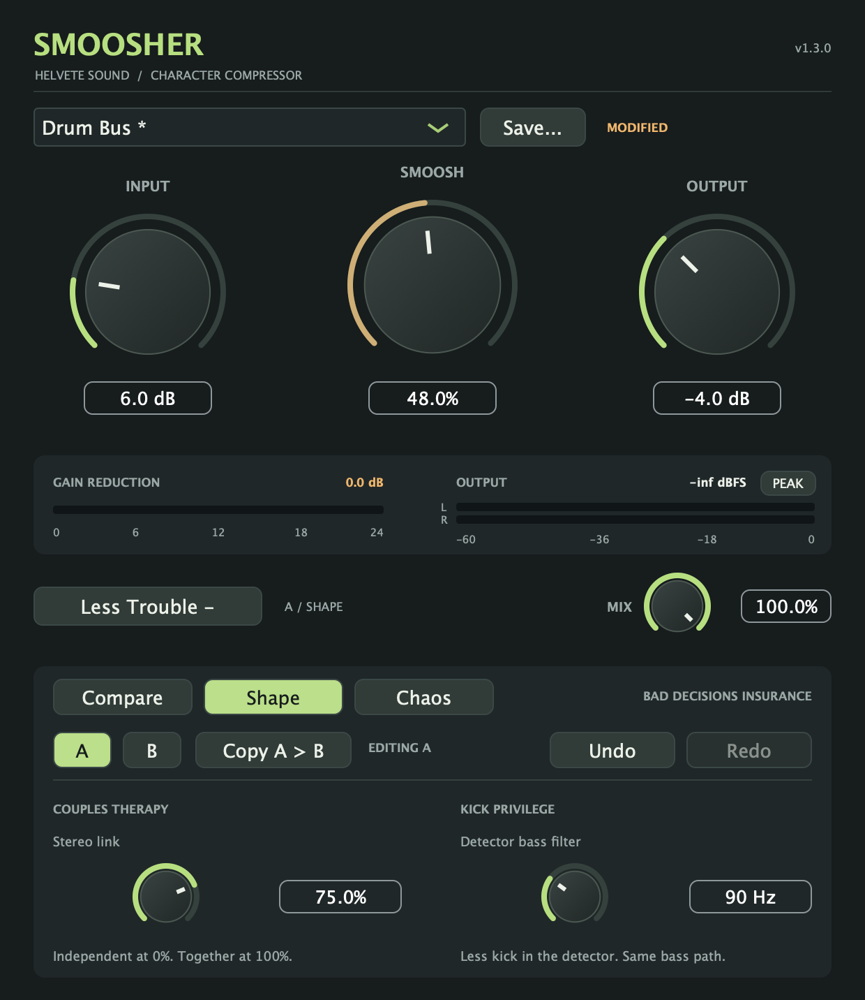
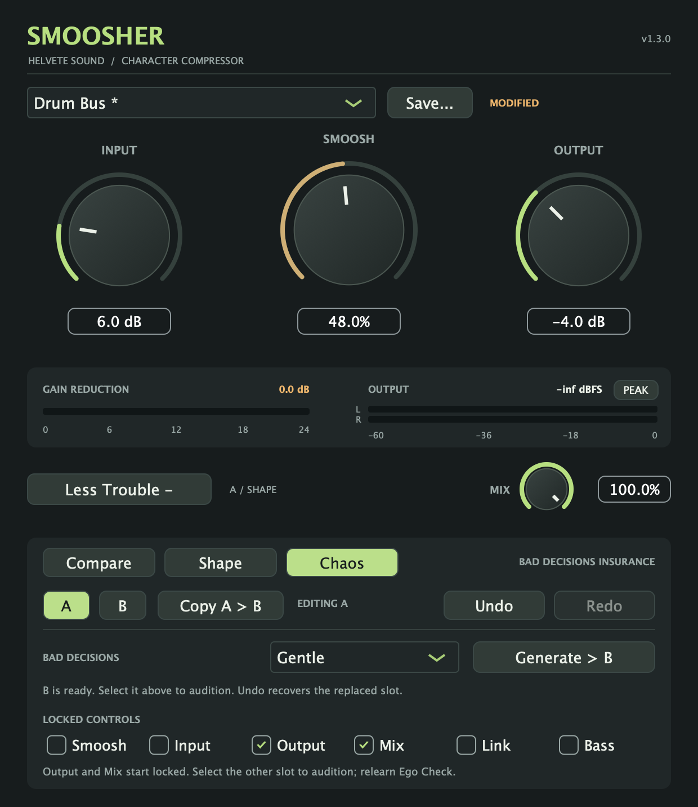

# Smoosher 1.3.0 — Professional Help

Couples Therapy, Kick Privilege, and Bad Decisions. Still free. Still ridiculous. This tester prerelease keeps the main controls compact and puts the new tools inside **More Trouble**.

## What's new

- **Couples Therapy:** 0–100% stereo gain-reduction linking. At 0%, channels compress independently; at 100%, both receive the stronger reduction. Mono is unaffected.
- **Kick Privilege:** Off/20–300 Hz detector bass filtering. Reduce kick-driven compression without filtering bass out of the audible signal path.
- **Bad Decisions:** Gentle, Questionable, and Unsupervised variations generated into the inactive A/B slot. Output and Mix start locked; all six controls can be locked. Your active sound stays put, Undo recovers the overwritten slot, and generated sounds start with Ego Check cleared for a fresh match.
- **More Trouble tabs:** Compare keeps A/B, Undo/Redo, and Ego Check; Shape holds the new audio controls; Chaos holds variations. A/B and Undo stay available on every tab. The main view remains 620 × 470, expanding to 620 × 716.
- **Session and preset support:** both Shape controls are automatable and included in A/B, Undo, sessions, and new user presets. Chaos preferences and the selected tab save with your session.

## Existing sessions

Older sessions explicitly restore Stereo Link to 0% and the detector filter to Off, including when loaded into an instance that already used Shape. Both 1.2 A/B slots and their Ego Check corrections are retained. Regression tests compare the default audio path bit for bit against the shipped 1.2 DSP in mono and stereo at 44.1, 48, and 96 kHz, including control transitions.

Original plugin IDs, parameter IDs/order/ranges, and factory preset settings are unchanged; two Shape parameters are appended. Factory presets and old user presets reset Shape to its legacy defaults. New user preset files use version 2 and require Smoosher 1.3 or later. Mix remains independent of preset changes.

## Downloads

- **macOS:** [Smoosher-1.3.0-macOS-universal.pkg](https://github.com/seamoss/smoosher/releases/download/v1.3.0/Smoosher-1.3.0-macOS-universal.pkg) installs AU and VST3 for Apple Silicon and Intel. Requires macOS 11 or later and administrator authorization. Release installers are Developer ID signed, notarized, and stapled.
- **Windows:** [Smoosher-1.3.0-Windows.zip](https://github.com/seamoss/smoosher/releases/download/v1.3.0/Smoosher-1.3.0-Windows.zip) contains the unsigned x64 VST3 bundle, README, guides, and screenshots. Extract it and copy the entire `VST3/Smoosher.vst3` bundle to `C:\Program Files\Common Files\VST3\`.
- **Checksums:** [SHA256SUMS.txt](https://github.com/seamoss/smoosher/releases/download/v1.3.0/SHA256SUMS.txt) covers both downloads.

Close your DAW before installing. When upgrading from a manual Mac install, move old per-user Smoosher copies out of `~/Library/Audio/Plug-Ins/Components/` and `~/Library/Audio/Plug-Ins/VST3/` to avoid duplicate versions, then rescan in your DAW. The Mac installer writes to the system `/Library/Audio/Plug-Ins/` directories. Previous releases remain available, including [1.2.0](https://github.com/seamoss/smoosher/releases/tag/v1.2.0).

## Interface and guides

Read the [quick start](../USAGE.md) and [More Trouble guide](../MORE-TROUBLE.md). Screenshots are rendered from the actual editor; meter readings depend on your audio.

## Validation and feedback

Local validation passed universal AU/VST3/standalone builds, the processor regression suite, five release-script tests, Mac architecture/version checks, AU validation on Apple Silicon and Intel, and VST3 pluginval strictness 5 with GUI tests skipped. Separate editor checks passed Shape gestures, Undo/Redo, and history persistence through timer updates.

[Main CI](https://github.com/seamoss/smoosher/actions/runs/43123484927) and [release CI](https://github.com/seamoss/smoosher/actions/runs/43124441343) passed Mac/Windows builds, processor regressions, release-script tests, and AU validation from commit `e099d837f78e65af935eaae9764472f181641b7e`. The tag run signed and notarized the universal installer, stapled its ticket, and created the release assets.

The exact downloaded assets passed SHA-256 checks. The Mac installer passed Developer ID signature, stapled-ticket, Gatekeeper, embedded bundle signature, architecture/version/identifier, minimum-OS metadata, and install-path checks. Apple reported **Accepted** with no notarization issues. The signed VST3 extracted from that installer passed pluginval strictness 5 with GUI tests skipped. The Windows ZIP passed CRC, x64 PE, 1.3.0 manifest, and bundled-documentation checks; its VST3 class identifiers match shipped 1.2.

Please test AU/VST3 scanning, playback, Shape automation, variation locks, A/B auditioning, Undo, Ego Check relearning, and reopening old and new sessions. Wider DAW playback, real Windows DAW testing, clean-machine installation, and older supported macOS versions still need tester feedback. Windows binaries are unsigned. Ego Check is RMS matching, not a peak limiter.

[Report issues](https://github.com/seamoss/smoosher/issues) with your OS, DAW/version, format, sample rate, buffer size, and reproduction steps.
