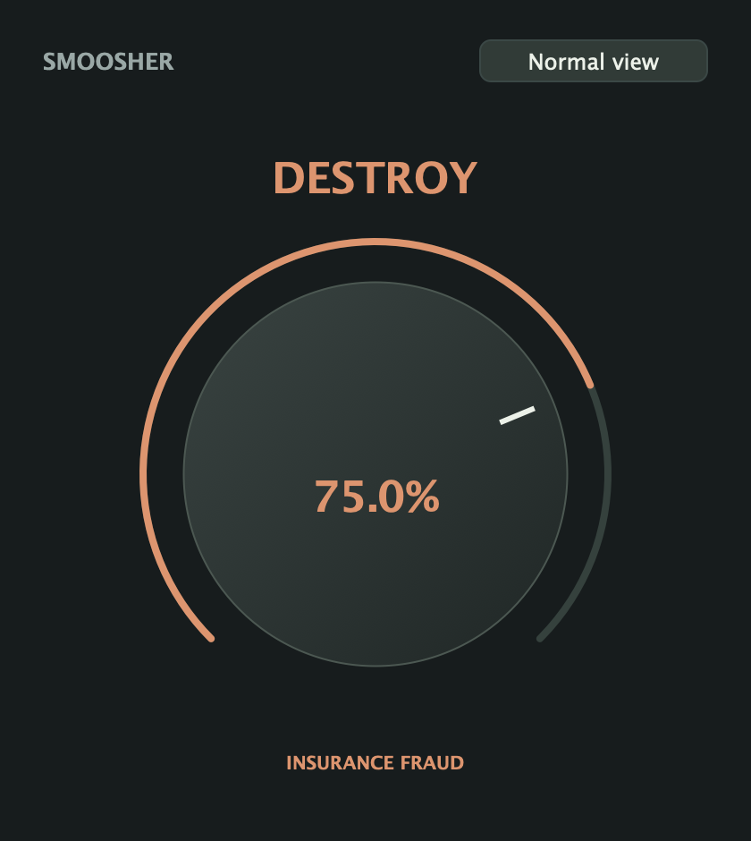

# Smoosher 1.3.1 — Destroy

One knob. Pre-calculated insanity. Still free.

## What's new

- **Destroy view:** click Destroy in the header for a 420 × 470 view with one large knob, a damage label, and a Normal view return button. No other sound controls, presets, or meters.
- **A fixed damage curve:** drive, compression/Hammer, parallel blend, and output compensation move together from clean zero to **Total Loss**. Drag or scroll; double-click for clean. The output compensation is fixed, not adaptive loudness matching.
- **Normal stays saved:** return to your previous controls, preset, A/B slots, Ego Check correction, and drawer/tab. Normal's compressor envelopes stay warm while Destroy is active; mode changes crossfade over 20 ms.
- **Automation, sessions, and Undo:** Destroy amount and mode are automatable and saved with the session. Gestures and mode changes participate in grouped Undo/Redo. Destroy is separate from Normal's A/B slots and user preset files.

Entering Destroy cancels unfinished Ego Check learning and releases Hold for Dry while retaining a prior correction for Normal. Destroy uses both processing paths while active, so it uses more CPU; no latency is added.

## Existing sessions

Sessions from before 1.3.1 explicitly load with Destroy off and its amount at zero, including when loaded into an instance that already used it. The six existing parameter IDs/order, plugin identifiers, factory presets, and Normal processing remain intact; the two new parameters are appended.

Regression tests verify bit-identical Normal audio before and after Destroy at 44.1, 48, and 96 kHz, in mono and stereo, including its warmed compressor envelopes. Existing tests retain the frozen 1.2 DSP comparison and prior-session migration coverage.

## Downloads

- **macOS:** [Smoosher-1.3.1-macOS-universal.pkg](https://github.com/seamoss/smoosher/releases/download/v1.3.1/Smoosher-1.3.1-macOS-universal.pkg) installs AU and VST3 for Apple Silicon and Intel. Requires macOS 11 or later and administrator authorization. Release installers are Developer ID signed, notarized, and stapled.
- **Windows:** [Smoosher-1.3.1-Windows.zip](https://github.com/seamoss/smoosher/releases/download/v1.3.1/Smoosher-1.3.1-Windows.zip) contains the unsigned x64 VST3 bundle, README, guides, and screenshots. Copy the entire `VST3/Smoosher.vst3` bundle to `C:\Program Files\Common Files\VST3\`.
- **Checksums:** [SHA256SUMS.txt](https://github.com/seamoss/smoosher/releases/download/v1.3.1/SHA256SUMS.txt) covers both downloads.

Close your DAW before installing. The Mac installer writes to the system `/Library/Audio/Plug-Ins/` directories. If upgrading from a manual installation, move old per-user Smoosher copies out of `~/Library/Audio/Plug-Ins/Components/` and `~/Library/Audio/Plug-Ins/VST3/` to avoid duplicates, then rescan. [1.3.0](https://github.com/seamoss/smoosher/releases/tag/v1.3.0) remains available.

## Interface and guides

Read the [Destroy guide](../DESTROY.md), [quick start](../USAGE.md), and [More Trouble guide](../MORE-TROUBLE.md). Screenshots come from the actual editor.

## Validation and feedback

Local checks passed universal AU/VST3/standalone builds, the processor/editor regression suite, five release-script tests, bundle/version checks, Apple Silicon and Intel AU validation, and VST3 pluginval strictness 5 with GUI tests skipped. New tests cover the single-knob view, old/new session recall, Undo/Redo, clean zero, frozen Normal matching, oversized host blocks, 20 ms mode transitions, block-size-independent smoothing, reference-signal output levels, and unchanged Normal audio. Standalone checks verified the knob, Normal settings/drawer restoration, and remembered Destroy amount.

Release CI and downloaded-artifact verification are pending at this source snapshot; the published GitHub release notes will record their outcome.

Please test Destroy and Normal in your DAW: switch views during playback, automate amount/mode, save and reopen sessions in each view, Undo changes, and compare older sessions. Wider DAW playback, real Windows DAW testing, clean-machine installation, and older supported macOS versions still need tester feedback.

[Report issues](https://github.com/seamoss/smoosher/issues) with your OS, DAW/version, format, sample rate, buffer size, and reproduction steps.
